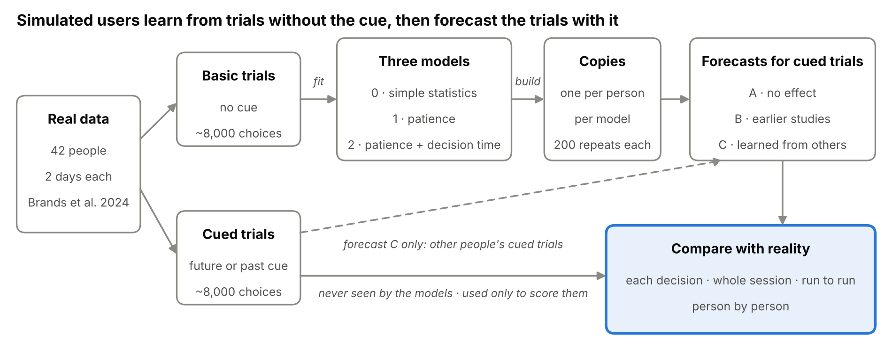
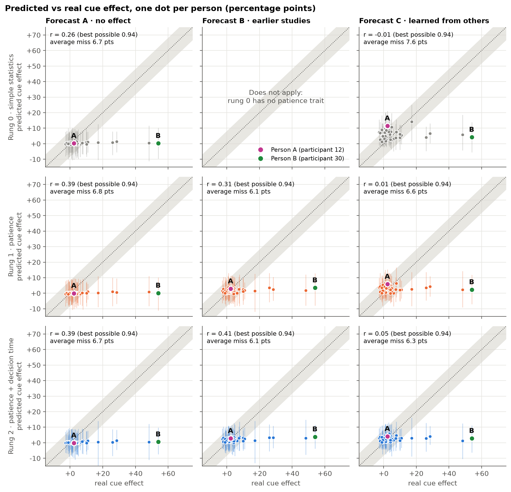
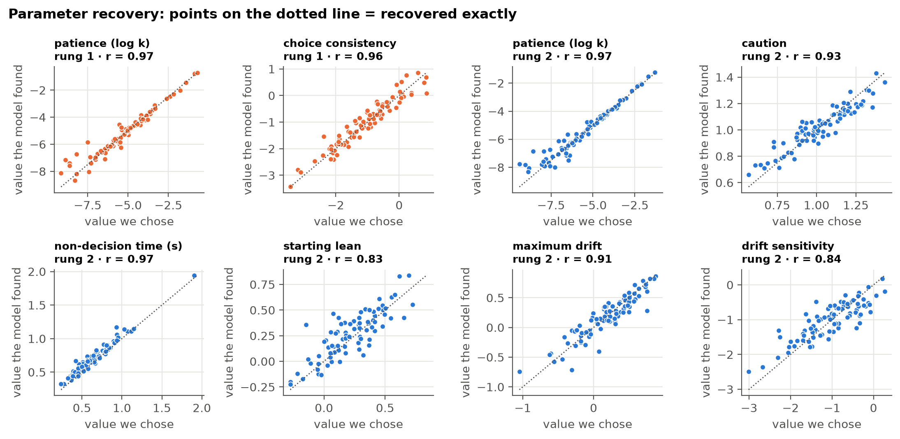
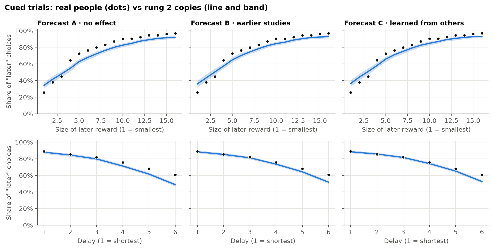
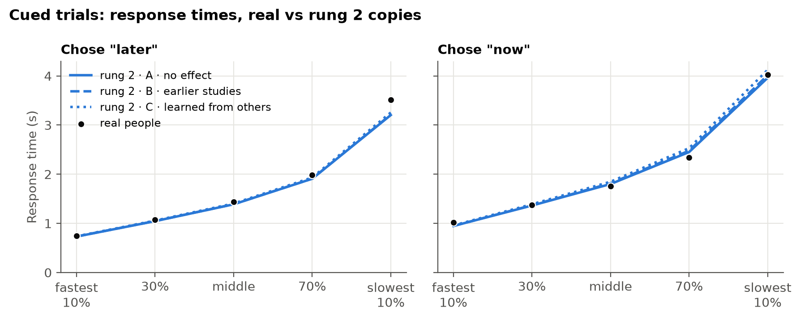
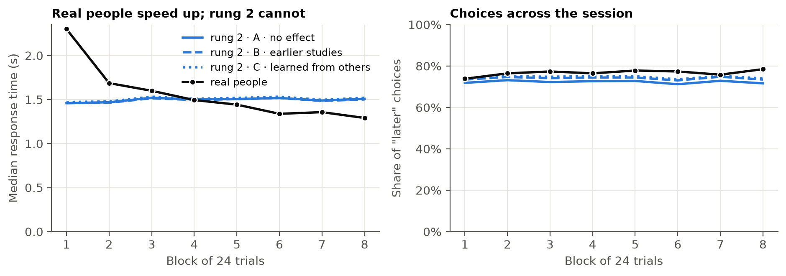
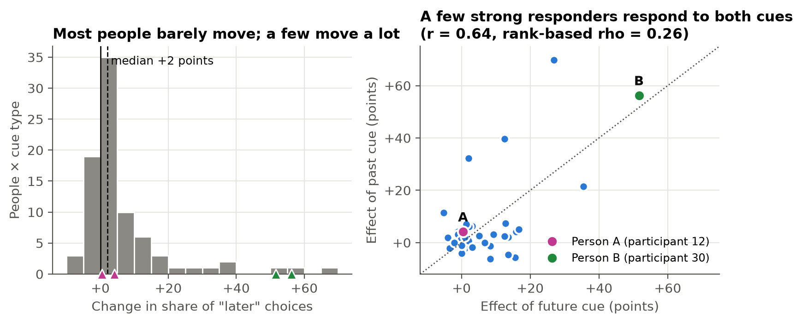
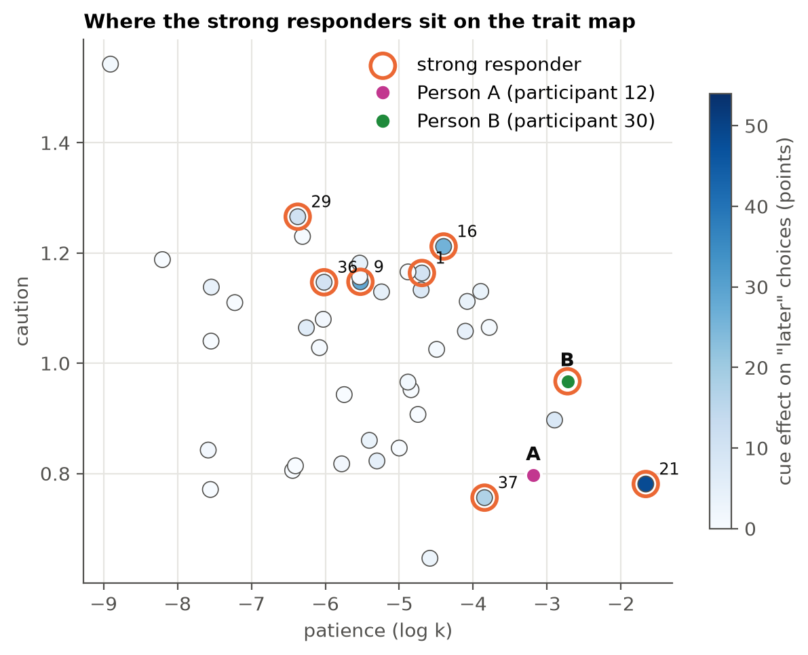
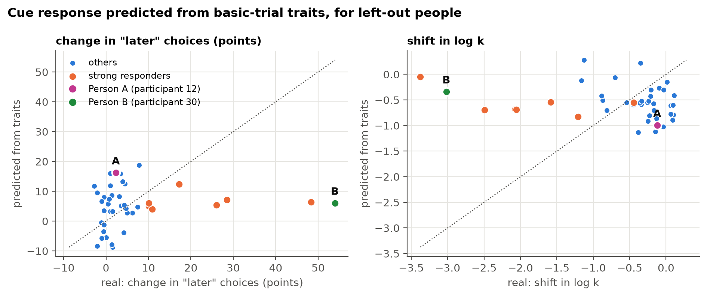

# Can simulated users predict how real people respond to a cue?

## TLDR

Companies often want to know how people will react to a change before they build it. One way to do this is to create simulated users, i.e. computer models that make choices the way real people do, and then try the change on them first.

This project tests a version of that idea on a small scale, using real, open-source human data from Brands et al. (2024). Brands and colleagues assessed how 42 people choose between getting smaller amounts of money immediately versus larger amounts of money in the future, and how personal cues influence these decisions (i.e. 20 euros right now or 35 euros in 4 months which is also you're going on holiday).
I built simulated users from how 42 people behaved **without** a particular cue, then asked them to predict how the same people behaved **with** that cue. The simulated users made three forecasts: (A) the cue has no effect; (B) the cue has an effect based on earlier studies; (C) the cue has the effect measured in other participants in this dataset. Then I checked the forecasts against what the real people actually did.

**Two people to follow.** Throughout this page I follow two real participants, shown in pink and green in every figure that has one dot per person.

- **Person A** (participant 12, pink) barely responds to the cue. They chose the later reward on 35 to 46% of basic trials, and 2 points more often with the cue.
- **Person B** (participant 30, green) responds more than almost anyone. They chose the later reward on 24 to 38% of basic trials, and **54 points** more often with the cue: 90% with the future cue and 80% with the past cue.

Without the cue, the two look almost the same: both are impatient, and to both of them €40 in 60 days feels like about €6 to €13 today. The question this project asks is whether simulated copies of them could have told them apart.

**What I found**

1. **Ignoring the cue misses its whole effect.** Real people chose the later reward 6.3 percentage points more often with the cue. Simulated users that were told nothing about the cue predicted a change of about 0.2 points.
2. **"The cue makes everyone a bit more patient" explains only a third to a half of the effect**, even when the size of the change is learned from the data (2 to 3 points predicted, against 6.3 real).
3. **The effect comes from a few people.** About 8 of the 42 people produce most of it; four of them changed by 26 to 54 points. Nothing in their behaviour without the cue identified them in advance. Person B changed by 54 points, and every model predicted under 5.
4. **The decision-time model reproduces response times well**, about twice as accurately as a model without timing. It misses three things: the slight slowing on cued trials, the speed-up across a session, and the way slow responses follow slow responses.

*Headline result. One dot per person: the cue effect each person's simulated copy predicted (vertical) against the real one (horizontal), for each model (rows) and forecast (columns). Dots on the dotted diagonal would be perfect predictions. The grey band is measurement noise: a perfect model would land inside it about 19 times in 20. Most people sit near zero; the few who changed most are far to the right, and every model predicted them to barely change. Person A (pink) sits near zero with the crowd. Person B (green) is the dot furthest right in every panel, and still predicted to change by at most 5 points.*

The lesson for simulated users: a simulated population needs differences in **how people respond to a change**, not just in their baseline traits, and baseline behaviour alone cannot tell you who will respond.

The plan and the [analysis specification](ANALYSIS_SPEC.md) were written before any model was fitted. Changes made while building the analysis are recorded there.

## The problem

Most people prefer a smaller reward immediately over a bigger reward later. "€20 today" often beats "€40 in two months", even when waiting is clearly the better deal. This is called temporal discounting.

Simple cues can change this. If you remind someone of something real in their own life at that later date ("€40 in two months, around your dad's birthday"), the future feels more concrete and people wait more often. In other words, they become less impulsive.

That cue is like a small design change in an app. So the question is: **if we only watch people choose without being cued, can we predict what they will do when they are cued? And can we predict who will be affected most?**

## The data

A public dataset from Brands and colleagues (University of Cologne, 2024):

- 42 adults, each tested on two separate days, completed a temporal discounting task.
- On every trial, a choice between €20 now and a larger amount later.
- Half the trials are basic (no cue). Half come with a personal reminder of an event at that time: a future event on one day, a past event on the other.
- For every trial we know what the person chose and how long they took.

Trials answered in under 0.25 s (too fast to be a real decision) or over 10 s (mind-wandering or an interruption) were removed: 133 of 16,128 trials (0.8%).

## The plan

1. **Learn from the basic trials only.** Estimate each person's traits (how patient they are, how carefully they decide) from their basic, non-cued trials.
2. **Create simulated users.** Build a simulated copy of each real participant, with that person's traits.
3. **Check the copies on the basic trials.** Before testing anything new, the copies should choose and take time like the real people on the trials they learned from.
4. **Make a forecast for the cued trials.** A copy has only ever seen basic trials, so it has no idea what a cue does. To predict the cued trials, we have to tell it what we expect the cue to do. Three forecasts:
    - **A. No effect.** The cue changes nothing. This shows the cost of simulating users without knowing about the design change.
    - **B. Earlier studies.** The cue makes people more patient by the amount found in six older experiments (Peters, 2020). This is like forecasting a new feature from past experience with similar ones.
    - **C. Learned from other people.** The cue's effect is measured in 35 participants and used to predict the other 7, rotating until everyone is predicted. This is like running a small pilot before a full launch.
5. **Compare with reality, person by person.** Each copy's forecast is compared with what its own real person did on the cued trials, in both choices and timing. No copy ever learns from the cued trials of the person it is copying.

**What forecast B really tests.** It changes one named trait (patience) and nothing else. The test is whether everything else follows from that one change: the choice curves, the response times, and how much people differ from each other. Getting patience right does not guarantee the rest.

## The simulated users

Each model adds a little more psychology than the one before. The point is to see how much each addition helps.

| | Model | In plain words |
| --- | --- | --- |
| 0 | Simple statistics (logistic regression) | Predicts choices from the amounts and delays. No psychology. |
| 1 | Patience model (hyperbolic discounting) | Each person has a patience level that shrinks the value of later rewards. |
| 2 | Patience + decision time (drift-diffusion model) | Also predicts how long each choice takes: easy choices are fast, close calls are slow. This is the model family the original authors used. |

A fourth model, adding practice and shifts of attention during a session, was planned. The results below show exactly what it would need to fix, so it is described under [What I would do next](#what-i-would-do-next).

Every model is fitted to every one of the 42 real people, using only their basic trials. This gives each real person a set of traits under each model. Traits are never mixed between models. All models are hierarchical Bayesian (each person's traits are estimated together with the group's, so a person with noisy data is pulled gently towards the group average) and fitted in Stan.

### How the models work

**Patience.** The value today of a reward that comes later is worked out with the hyperbolic formula:

> value today = amount ÷ (1 + k × delay in days)

`k` is the discount rate. A **small k means patient**: future money keeps most of its value. A **big k means impatient**: future money shrinks fast. For a typical person in this dataset, k is about 0.005 per day, so €40 in 60 days feels like about €31 today. Persons A and B are much less patient than that: their k is 0.03 to 0.09 per day, so the same €40 feels like only €6 to €13.

Delay is hyperbolic because people do not discount at a steady rate. Value drops steeply over the first days and weeks, then more slowly. Decades of studies show this pattern (Mazur, 1987), and it is the standard model in this field.

**Choice consistency (rung 1).** Once each option has a value, the person still has to choose. People are reliable when one option is clearly better and close to a coin flip when the two are close. An S-shaped (logistic) curve turns the value gap into a probability of choosing "later". Choice consistency sets how steep the S is.

**How the decision unfolds (rung 2).** Rung 2 uses the same patience formula, then models the decision as evidence building up over time until it reaches a threshold for "later" or "now" (a drift-diffusion model). Its traits are:

- **Drift rate:** how fast evidence builds. It grows with the value gap along an S-shaped curve, so it levels off (Fontanesi et al., 2019; Peters & D'Esposito, 2020). Two traits set it: maximum drift and drift sensitivity.
- **Caution (boundary separation):** how much evidence the person needs before deciding.
- **Non-decision time:** time spent seeing the offer and pressing the key.
- **Starting lean:** a tilt towards "later" or "now" before any evidence arrives.

### Simulated agents

- **Copies** are built from a real person's estimated traits. Each copy does exactly the trials its real person saw, 200 times, each time with a slightly different plausible version of that person's traits. The spread across the 200 repeats shows how sure the model is. For example, Person B's copy does Person B's roughly 380 trials 200 times, using only what Person B's basic trials revealed about them.
- **Invented agents** have traits chosen by us. They are used only to test whether a model can measure traits correctly.

## How the forecasts were judged

I use the three behavioural fidelity checks to see how closely simulated behaviour matches real behaviour:

- **Each decision.** For a given offer, do the copies choose "later" about as often as real people, and take about as long?
- **The whole session.** Does behaviour unfold over time the way it does for real people?
- **Run to run.** Every measure is computed in each of the 200 repeats and reported with the range covering 95% of them.

Every score is set against what a perfect model could achieve, given how noisy real behaviour is. For example, each person's cue effect rests on about 380 trials, so it can only be measured to within about ±4 points. Even a perfect model would miss it by that much.

## Results

### 1. Can the models be trusted?

- **Fitting:** all three models passed the standard checks (chains agree, enough effective samples, no warnings).
- **Parameter recovery:** invented agents with known traits did the task, and the models found those traits again. Correlations between true and recovered traits were 0.83 to 0.97 for every trait (pass mark 0.8). So when a model says a real person is patient or cautious, the number can be believed.

  

- **Basic trials:** the copies reproduced how choices rise with reward size and fall with delay, and rung 2 reproduced the full spread of response times. One miss is shared by every model: when the later reward is only a little above €20, real people choose it about 15% of the time; the models predict 30 to 35%.

### 2. Forecasts against reality

The headline figure is at the top of this page. The scorecard below puts every model and forecast side by side.

| Model · forecast | Predicted cue effect (pts) | Reward-size curve error (pts) | Delay curve error (pts) | Response-time error (s) | People inside the noise band |
| --- | --- | --- | --- | --- | --- |
| **Real people / as good as it gets** | **+6.3** | **2.1** | **1.8** | | **95%** |
| 0 · A no effect | +0.3 | 6.7 | 6.0 | 0.16 | 81% |
| 0 · C learned from others | +6.0 | 4.3 | 1.6 | 0.15 | 76% |
| 1 · A no effect | +0.1 | 6.2 | 4.9 | 0.16 | 81% |
| 1 · B earlier studies | +1.8 | 5.2 | 3.3 | 0.16 | 83% |
| 1 · C learned from others | +2.9 | 4.6 | 2.2 | 0.16 | 86% |
| 2 · A no effect | +0.2 | 6.3 | 4.5 | 0.08 | 81% |
| 2 · B earlier studies | +2.0 | 5.3 | 2.8 | 0.09 | 83% |
| 2 · C learned from others | +2.6 | 5.0 | 2.4 | 0.09 | 86% |

*All measures are on the cued trials, averaged over 200 repeats. **Predicted cue effect:** the change in "later" choices from basic to cued trials. **Curve errors:** the average gap between the copies' and real people's share of "later" at each reward size (16) or delay (6); the top row is how far two equally valid samples of 42 people would differ by chance. **Response-time error:** the average gap in response times from the fastest to the slowest 10%; rungs 0 and 1 have no model of time, so they serve as a comparison point. **Noise band:** the share of people whose predicted cue effect lies within measurement noise of their real one; a perfect model would reach about 95%. Forecast B's smaller and larger cases gave cue effects of +0.8 to +3.0.*

- **Forecast A misses the whole effect.** Simulating users without knowing about the design change is wrong by about 6 points.
- **Forecasts B and C recover a third to a half of it.** When the cue can act only by making people more patient, even the best-fitting shift explains less than half the real change. Rung 0 gets the average right because it can move its baseline directly, but it has no psychology to explain why.
- **The miss is concentrated in a few people.** Most people sit near zero, both really and in the predictions, and 76 to 86% of people fall inside the noise band. The people who changed most (up to +54 points) were all predicted to change by 0 to 4 points.
- **Persons A and B get almost the same forecast.** Because they look alike on basic trials, their copies predict nearly the same change:

  | Forecast (rung 2) | Person A predicted | Person B predicted |
  | --- | --- | --- |
  | A · no effect | −0.2 | +0.6 |
  | B · earlier studies | +2.7 | +3.8 |
  | C · learned from others | +4.1 | +2.8 |
  | **Real change** | **+2.3** | **+54.0** |

  Every forecast is about right for Person A and about 50 points short for Person B. Forecast C, which overshoots slightly for A, is no closer for B. Each person's forecast C shift was learned from the other 35 people, and it was about the same small shift for everyone.
- **More psychology did not predict choices better.** Rungs 1 and 2 performed alike on choices; most trials are easy, and the two share the same patience formula.

### 3. Timing

- **Rung 2 reproduces response times well.** Its response-time error on cued trials was 0.08 to 0.09 s, against 0.15 to 0.16 s for models that have no model of time.
- **The cue slows people slightly, and no forecast predicted it.** Real people took about 58 ms longer on cued trials. Every forecast predicted about 0, including forecast C, which was allowed to make people more careful. A likely reason: a cued trial shows extra text, and reading it takes time. That would lengthen non-decision time, which no forecast was allowed to change.
- **Person B goes the other way.** With the cue, Person B became *faster* as well as more patient: their median response time fell from 2.4 to 1.9 s on day 1 and from 1.7 to 1.2 s on day 2. Their rung 2 copies, under forecast C, predicted a median of 2.0 s on cued trials against a real 1.5 s. For Person A the copies were close (1.3 s predicted, 1.4 s real). For Person B, the cue seems to have made the choice easy, not just shifted their patience.

- **Real people speed up; the model cannot.** Real response times fall from about 2.3 s to 1.3 s across a session. Rung 2 stays flat at about 1.5 s, because nothing in it changes with practice.
- **Slow responses follow slow responses.** In real people, a trial's response time is linked to the next one's (carry-over +0.065). In rung 2 copies it is −0.04, the value expected for trials that are completely independent. Real attention drifts; the model's does not.

### 4. Who responds?

*Left: each person's change in "later" choices with each cue type. Most barely move; a few move a lot. The pink triangles mark Person A's two cue effects (+0 and +4); the green triangles mark Person B's (+52 and +56). Right: the few strong responders respond to both cues, but for everyone else responding to one cue says little about the other. Person B sits near the diagonal far top-right; Person A sits in the crowd near zero.*

*People placed by patience and caution, coloured by how much the cue changed their choices. Strong responders are ringed. Persons A (pink) and B (green) are neighbours on the impatient side of the map, but only B is ringed.*

- **8 of 42 people respond strongly** (a change bigger than the measurement noise, +8.3 points). Four of them changed by 26 to 54 points.
- **Responding to cues is a stable trait only for the biggest responders.** They responded strongly to both the future and the past cue. For everyone else, responding to one cue barely predicted responding to the other (rank correlation 0.26).
- **The strong responders are scattered across the map,** not grouped in one corner.
- **Nothing thus far predicted who would respond.** Predicting each person's response from their patience, caution and non-decision time, tested on people left out of the fit, did slightly worse than predicting the average for everyone (average miss 8.8 points against 8.3). For our two people it got the order backwards: it predicted +16 points for Person A (real +2) and +6 for Person B (real +54).
- **How big Person B's change is in model terms.** Fitting patience separately on cued and basic trials, the cue cut Person B's discount rate (k) by a factor of about 12 with the past cue and 34 with the future cue. For Person A, k barely changed. The forecasts assumed changes of about 1.2 to 1.4 times.
- **Two leads (not findings).** Strong responders were less patient to begin with (choosing "later" on 58% of basic trials against 73%, p = 0.10) and had lower maximum drift, meaning their choices were less driven by value (p = 0.01, which does not survive a correction for testing 7 traits). Both suggest people with more room to move, and weaker value-driven choices, respond more. A new study would need to test this.

*Each person's cue response predicted from their basic-trial traits, for people left out of the fit. Dots on the dotted diagonal would be perfect predictions. Strong responders (orange) are all predicted to change by about 4 to 12 points, wherever their real change lies. Person B (green) is the furthest right.*

## Limitations

- **42 healthy adults is a small group,** and only about 8 of them drive the cue effect. Any statement about who responds rests on very few people.
- **No questionnaires.** The dataset has no personality or clinical measures, so responders can only be described by their behaviour.
- **Not a blind test.** The original results are published. The safeguard is that the plan, the models and the size of forecast B's effect were fixed before any forecast was compared with the cued trials.
- **Forecast B's effect size is approximate.** It is the middle of the range reported in the re-analysis of six earlier experiments (−0.07 to −0.28 on log k), because the per-experiment table could not be accessed.
- **A known misfit:** all models expect people to wait for tiny gains more often than they do.
- **Strict fit checks on the basic trials were failed.** With about 8,000 trials, the expected range for each reward size is very narrow, so misses of 2 to 4 points count as failures. The sizes of the misses are reported alongside.
- **One task, one cue.** Intertemporal choice with episodic cues is a clean test case, not a product. How far the findings carry over to real interfaces is untested.

## What I would do next

The results point to four extensions, in order of how much they would improve the simulated users.

### 1. Let people differ in how they respond to the change

**Why:** this is the biggest miss. Every forecast gave everyone roughly the same response to the cue, but in reality most people barely changed and a few changed a lot. A simulated population that gets the average right but the spread wrong will mislead any decision that depends on who is affected.

**How:** model each person's response to the cue as a mixture of two kinds. Most people are non-responders (patience shift near zero). A minority are responders, whose shift comes from a wide distribution. Fit the share of responders and the size of their shift on training participants, then let each simulated user be a responder with that probability. Judge it on whether the simulated population reproduces the **spread** of real cue effects (how many people move by 0, 10, 30 or 50 points), not only the average. This would not tell Persons A and B apart, because nothing in the basic trials does. But the simulated population would contain some copies that respond like Person B, in roughly the right proportion, instead of none.

### 2. Rung 3: practice and attention, so sessions unfold like real ones

**Why:** rung 2 treats every trial alike. Real people speed up from about 2.3 s to 1.3 s per decision across a session, their slowest decisions are slower than the model's, and slow responses follow slow responses. All three are signs of practice and of attention drifting in and out.

**How, in two steps, each checked before the next:**

- **3a · Practice.** Let caution and non-decision time change smoothly across the session. For each person-day, each starts at one level and settles towards another as trials go by (an exponential decay with a person-specific rate). This tests whether practice alone explains the speed-up.
- **3b · Attention states (hidden Markov model).** On every trial, the person is in one of two hidden states (states we cannot see directly, only infer from behaviour):
    - **Engaged:** they decide as in rung 3a.
    - **Lapsing:** their choice does not depend on the offer (drift fixed at zero), and how long a lapsed choice takes is left for the data to decide.

  States are "sticky": each person has a chance of staying engaged from one trial to the next, and a chance of staying lapsed. So lapses come in streaks, as real mind-wandering does. The model works backwards from choices and response times to the probability of each state on every trial (the forward algorithm, which Stan can run while fitting). This gives every person an extra trait: how much of the session they spend engaged.

**How it would be checked:**
- **Parameter recovery first.** Invented agents with known lapse rates should be recovered, and the model should not report lapses in data that has none. With 192 trials per session, lapses may be too rare to detect; if so, 3a stands as rung 3.
- **Then fidelity.** Rung 3 should reproduce the session time course, the carry-over, and the slow tail of response times, without losing what rung 2 already gets right.
- **Then the "who responds" question again.** Time spent engaged is a natural candidate for predicting who notices and uses the cue.

### 3. Let the cue change more than patience

**Why:** cued trials were about 58 ms slower, and no forecast predicted it.

**How:** allow the cue to change non-decision time (reading the personal event takes time) as well as patience and caution, and test which combination is needed to reproduce both the choices and the timing. In product terms: a design change that adds content also adds reading time, and a good simulated user should show that.

### 4. Collect what this dataset does not have

**Why:** behaviour without the cue could not identify the responders.

**How:** a new study, pre-registered, with more people and measures chosen to predict responding to episodic cues: how vividly people imagine future events, how connected they feel to their future self, and impulsivity scales. Each person would do the task twice with the same cue type, so responding can be measured reliably within a person. The two leads above (starting patience and value-driven choice) would be tested directly.

A smaller fix along the way: give the models a small extra pull towards "now" (or a curved value of money), so they stop expecting people to wait for a gain of a few cents.

## Repository

| Folder or file | Contents |
| --- | --- |
| `README.md` | This page |
| `ANALYSIS_SPEC.md` | The analysis plan, written before fitting, with changes recorded |
| `SETUP.md` | How to install and run everything |
| `notebooks/01_data.ipynb` | Loading, exclusions, first look at the data |
| `notebooks/02_models_fit.ipynb` | Fitting rungs 0 to 2 to the basic trials |
| `notebooks/03_model_checks.ipynb` | Convergence, basic-trial match, parameter recovery |
| `notebooks/04_forecasts.ipynb` | Copies make forecasts A, B and C for the cued trials |
| `notebooks/05_fidelity.ipynb` | Forecasts compared with real behaviour |
| `notebooks/06_who_responds.ipynb` | Who responds to the cue |
| `stan/` | The models |
| `src/` | Shared code for fitting, simulating and scoring |
| `figures/` | All figures |

The raw data is not included. Download `dd_rawdata.txt` from the [Brands et al. OSF project](https://osf.io/rhz2f/) and place it in `data/raw/`.

## References

- Brands, A., Shebotinova, E., Herbertz, A., Knauth, K., Marteau, A., & Peters, J. (2024). Future and past episodic cues reduce temporal discounting and increase control allocation during inter-temporal choice. Preprint: <https://doi.org/10.31219/osf.io/yn4sb>. Data: <https://osf.io/rhz2f/>
- Fontanesi, L., Gluth, S., Spektor, M. S., & Rieskamp, J. (2019). A reinforcement learning diffusion decision model for value-based decisions. *Psychonomic Bulletin & Review*, 26, 1099–1121.
- Mazur, J. E. (1987). An adjusting procedure for studying delayed reinforcement. In M. L. Commons et al. (Eds.), *Quantitative analyses of behavior: Vol. 5. The effect of delay and of intervening events on reinforcement value* (pp. 55–73). Erlbaum.
- Peters, J. (2020). Effects of episodic future thinking on temporal discounting: a re-analysis of six data sets using hierarchical Bayesian parameter estimation and compilation of effect sizes. *bioRxiv*. <https://doi.org/10.1101/2020.03.24.005892>
- Peters, J., & D'Esposito, M. (2020). The drift diffusion model as the choice rule in inter-temporal and risky choice: A case study in medial orbitofrontal cortex lesion patients and controls. *PLoS Computational Biology*, 16(4), e1007615.
